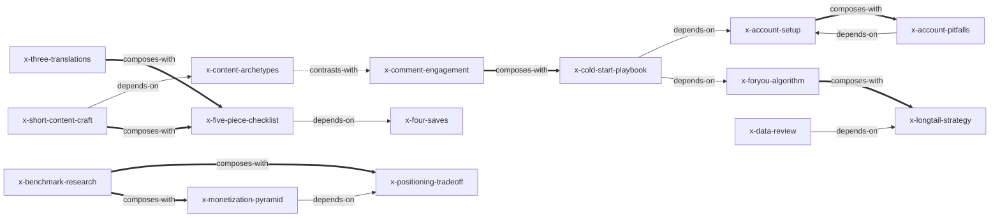

# X-growth-skills — Skill Index

> 本资料集由 cangjie-skill 蒸馏, 共产出 **15** 个 skills。
> 处理时间: 2026-07-14

## 关于这套资料

- **作者**: 多位创作者合集 — 向阳乔木 @vista8、木马人 @cnyzgkc、Yangyi @Yangyixxxx、AIP出海教程(@带队教练/GoSailGlobal)、X 官方 @XCreators、xAI 官方算法仓库
- **出版年**: 2024–2026 (跨年资料,核心算法部分截至 2026-05)
- **一句话主旨**: 把 X(Twitter) 从 0 冷启动做到可持续涨粉变现的完整方法论 —— 核心是"替读者省步骤"的内容哲学,靠理解算法 + 内容工程 + IP 定位 + 互动策略,系统性提高内容进入爆款池的概率,而非赌单条爆掉。
- **整书理解**: 见 [BOOK_OVERVIEW.md](./BOOK_OVERVIEW.md)
- **精华长文** (不读全书看这篇): [DIGEST.md](./DIGEST.md)
- **术语词典**: [GLOSSARY.md](./GLOSSARY.md)

---

## Skill 列表 (按主题分组)

### 内容哲学与生产

- [`x-four-saves`](./x-four-saves/SKILL.md) — 发帖前用"四省模型"估值内容价值(帮读者省几步路)
- [`x-three-translations`](./x-three-translations/SKILL.md) — 把公告式内部语言翻译成读者能拿走的外部语言(三次翻译)
- [`x-content-archetypes`](./x-content-archetypes/SKILL.md) — 按"读者拿到能做什么"分四类原型,预测传播上限
- [`x-short-content-craft`](./x-short-content-craft/SKILL.md) — 四类型+Hook-Body-CTA+爆款公式起草短内容
- [`x-five-piece-checklist`](./x-five-piece-checklist/SKILL.md) — 发布前五件套完备性自检(价值/场景/入口/证据/收藏理由)

### 算法与心态

- [`x-foryou-algorithm`](./x-foryou-algorithm/SKILL.md) — X 推荐算法推理结构与创作者行动推论
- [`x-longtail-strategy`](./x-longtail-strategy/SKILL.md) — 长尾分布心态,系统性提高进前 10% 概率

### 账号工程与冷启动

- [`x-account-setup`](./x-account-setup/SKILL.md) — 开店模型:装修/蓝V/养号开业准备
- [`x-cold-start-playbook`](./x-cold-start-playbook/SKILL.md) — 冷启动六策略+涨粉转化漏斗诊断
- [`x-account-pitfalls`](./x-account-pitfalls/SKILL.md) — 账号限流/风控自检与申诉恢复

### 互动与增长

- [`x-comment-engagement`](./x-comment-engagement/SKILL.md) — 六种评论互动法+Repost vs Quote 选择
- [`x-benchmark-research`](./x-benchmark-research/SKILL.md) — 对标账号 5 步研究法+变形出差异

### 定位与变现

- [`x-positioning-tradeoff`](./x-positioning-tradeoff/SKILL.md) — 不可能三角+IP vs 泛流量定位取舍
- [`x-monetization-pyramid`](./x-monetization-pyramid/SKILL.md) — 三层变现金字塔+5 种赚钱方法

### 复盘

- [`x-data-review`](./x-data-review/SKILL.md) — 80/20 数据复盘四步闭环

---

## 引用图



图例:
- `-->` depends-on (A 使用前提是先理解 B)
- `-.->` contrasts-with (A 和 B 看情境二选一)
- `==>` composes-with (A 和 B 常配合使用)

---

## 推荐学习顺序

(从依赖图的叶子节点开始,向上)

**第一层:基础与叶子 (无前置依赖)**

1. **x-four-saves** — 内容估值基础,发帖前判断"值不值得发"
2. **x-content-archetypes** — 内容分类基础,判断"这是哪类、传播上限多高"
3. **x-foryou-algorithm** — 算法机制基础,理解"为什么被推荐"
4. **x-account-setup** — 账号工程基础,开业前装修/蓝V/养号
5. **x-positioning-tradeoff** — 定位基础,选 IP 还是泛流量
6. **x-longtail-strategy** — 心态基础,接受长尾分布常态

**第二层:依赖第一层**

7. **x-short-content-craft** — 依赖 x-content-archetypes,原型决定类型选型
8. **x-five-piece-checklist** — 依赖 x-four-saves,先估值再查完备性
9. **x-cold-start-playbook** — 依赖 x-account-setup + x-foryou-algorithm,先开业再获客
10. **x-monetization-pyramid** — 依赖 x-positioning-tradeoff,先定路线再规划变现
11. **x-data-review** — 依赖 x-longtail-strategy,先有心态再做复盘
12. **x-account-pitfalls** — 依赖 x-account-setup,预防做对才能减少恢复

**第三层:独立工具 (配合使用)**

13. **x-three-translations** — 改写工具,配合 x-five-piece-checklist 使用(翻译完验证证据)
14. **x-comment-engagement** — 互动工具,配合 x-cold-start-playbook 使用(策略+战术)
15. **x-benchmark-research** — 研究工具,配合 x-positioning-tradeoff + x-monetization-pyramid 使用(定方向+找对标)

---

## 安装使用

本目录是仓库形式,宿主不会从这里加载 skill。要让 agent 真正调用,把需要的 skill 目录复制到宿主的 skills 目录:

```bash
# 用户级 (所有项目可用)
cp -r x-four-saves ~/.claude/skills/
cp -r x-content-archetypes ~/.claude/skills/
# ...按需复制

# 或项目级
cp -r x-four-saves <project>/.claude/skills/    # Claude Code
cp -r x-four-saves <project>/.cursor/skills/    # Cursor
```

> 注:本目录是仓库形式,用户已选择不自动安装。请按需手动复制所需 skill 到宿主 skills 目录。

---

## 接入 darwin-skill

所有 skill 均带有 `test-prompts.json` (darwin-skill 兼容格式), 可直接接入自动进化:

```
darwin evolve books/x-qihao-skills/
```

---

## 审计轨迹

- 候选单元池: [candidates/](./candidates/)
- 被淘汰的候选 (含原因): [rejected/](./rejected/)
- BOOK_OVERVIEW: [BOOK_OVERVIEW.md](./BOOK_OVERVIEW.md)
- GLOSSARY: [GLOSSARY.md](./GLOSSARY.md)
- 验证结果汇总: [verified.md](./verified.md)
- 流水线状态: [PIPELINE_STATE.md](./PIPELINE_STATE.md)
